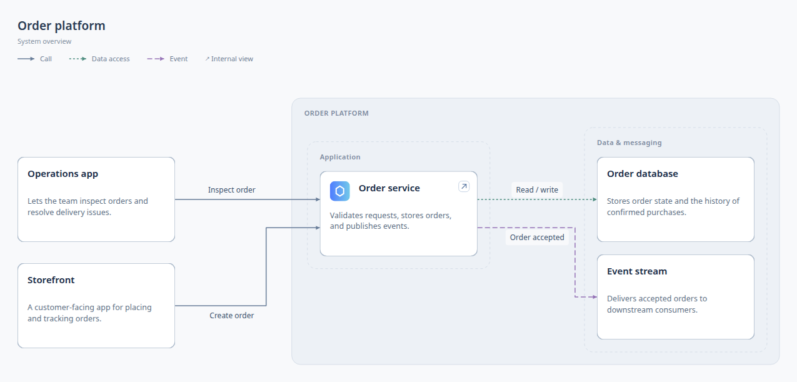
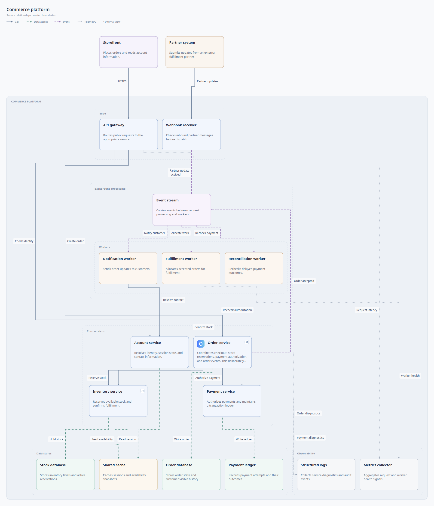
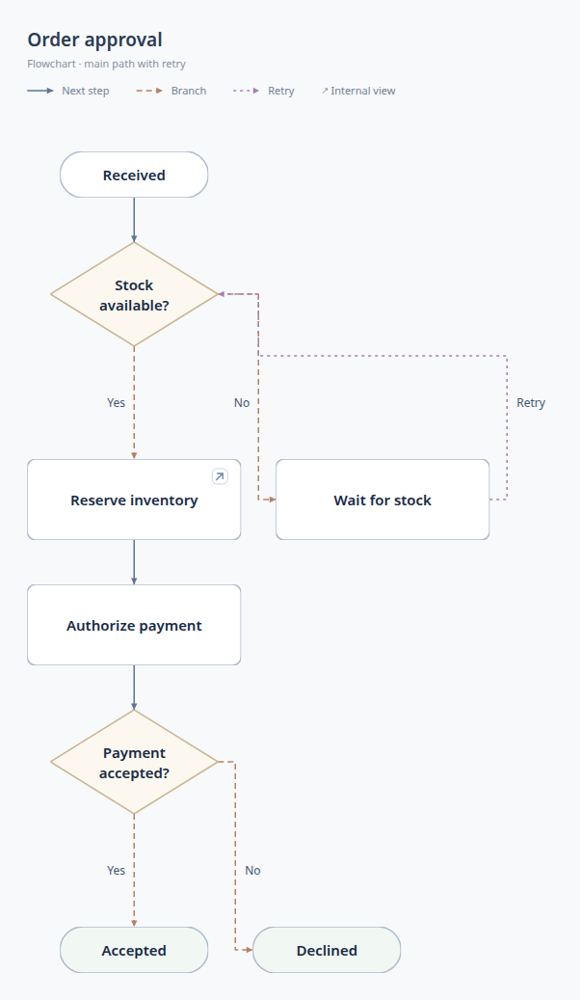

# Better Diagrams

Architecture diagrams and flowcharts for coding agents. Automatic layout, clickable details, browser editing, and offline HTML and SVG exports.

## Install

With Node.js 22.20 or later:

```sh
npx skills add ruohao1/better-diagrams --skill diagram-authoring -g
```

Select your agent, then ask it to use `diagram-authoring`. The skill includes its CLI. For direct terminal use: `npm install -g @isqrd/better-diagrams`.

## Showcase

| Architecture | Larger system | Flowchart |
| --- | --- | --- |
| [](docs/showcase.md#architecture-overview) | [](docs/showcase.md#larger-architecture) | [](docs/showcase.md#flowchart) |

[Full gallery, SVGs, and runnable examples →](docs/showcase.md)

<details>
<summary>Code example: API → database</summary>

Save this as `my-diagram/diagram.json`:

```json
{
  "version": 2,
  "title": "Order storage",
  "purpose": "Show where orders are stored.",
  "audience": "Developers",
  "rootViewId": "overview",
  "nodes": {
    "api": { "label": "API", "summary": "Accepts orders.", "details": "Validates incoming orders." },
    "db": { "label": "Database", "summary": "Stores orders.", "details": "Persists accepted orders." }
  },
  "views": {
    "overview": {
      "type": "architecture", "title": "Order storage", "detailLevel": "Components",
      "nodeIds": ["api", "db"],
      "edges": [{ "id": "save", "source": "api", "target": "db", "kind": "data", "label": "Save order" }]
    }
  }
}
```

To add a component, define it in `nodes`, include its ID in the view's `nodeIds`, and connect it with an edge. Use `kind: "call"` for service calls and `kind: "data"` for storage access.

With the CLI installed, build and open `diagram.html` in your browser:

```sh
better-diagrams build my-diagram --out diagram.html
```

For live editing, run `better-diagrams dev my-diagram`.

</details>

## Use cases

- Map a repository's services and dependencies, with code references in node details.
- Explain workflows with decisions, failures, and retry paths.
- Keep an overview readable and open component internals in a modal.

[Usage guide](docs/guide.md) · [Source format](skills/diagram-authoring/references/source-format.md) · [Changelog](CHANGELOG.md) · [Releases](https://github.com/ruohao1/better-diagrams/releases)
