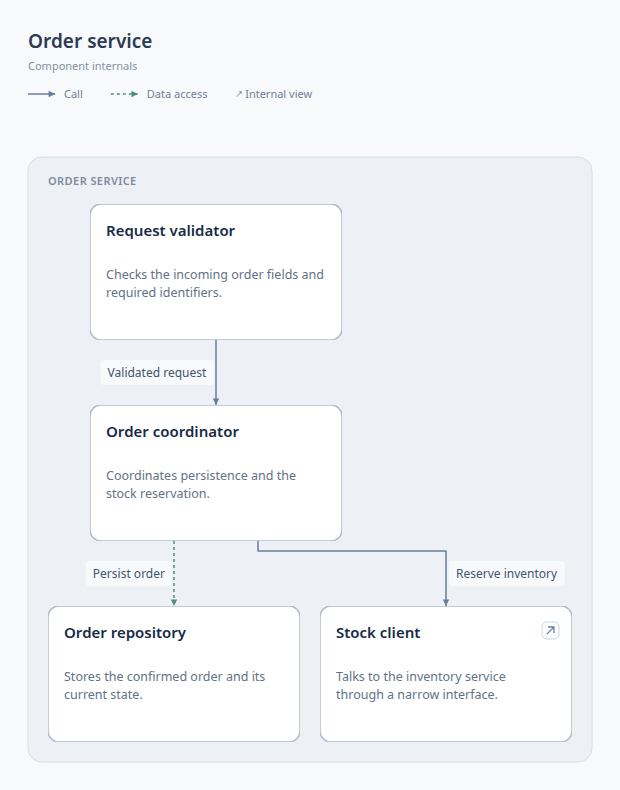

# Showcase

These previews are actual SVG exports from Better Diagrams, shown as PNGs. The commerce and order systems are synthetic examples. They do not describe this repository's architecture.

To explore them, clone the repository and run the commands below with Node.js 22.18 or later. The committed skill includes the runtime; no npm installation or build is needed.

```sh
git clone https://github.com/ruohao1/better-diagrams.git
cd better-diagrams
```

Open the URL printed by each `dev` command. Click a node for details, choose **Explore internals** for a deeper view, or use **Export SVG** for the complete active diagram. The images on this page are static.

## Architecture overview

Five components and four connections. Fixed-size cards, a local logo, typed connections, and nested boundaries keep the system overview compact.

[](showcase/architecture-small.svg)

[SVG](showcase/architecture-small.svg) · [Source](../examples/architecture-small/diagram.json)

```sh
node skills/diagram-authoring/bin/cli.mjs dev examples/architecture-small
```

### Component internals

In the overview, click **Order service**, then **Explore internals**. Its four-component view opens in a modal. **Back** returns to the previous view. Exporting here includes only the internal diagram and its legend.

[](showcase/order-service.svg)

[SVG](showcase/order-service.svg) · [Source](../examples/architecture-small/diagram.json)

## Larger architecture

Eighteen components and twenty-three connections across services, stores, workers, and observability. This example shows nested boundaries, different connection types, and longer routes. Use pan, zoom, or **Fit** to explore it in the browser.

[](showcase/architecture-dense.svg)

[SVG](showcase/architecture-dense.svg) · [Source](../examples/architecture-dense/diagram.json)

```sh
node skills/diagram-authoring/bin/cli.mjs dev examples/architecture-dense
```

## Flowchart

Eight steps and eight connections. An order moves through stock and payment decisions, with labeled outcomes and a retry path. **Reserve inventory** also has an internal view.

[](showcase/order-flow.svg)

[SVG](showcase/order-flow.svg) · [Source](../examples/order-flow/diagram.json)

```sh
node skills/diagram-authoring/bin/cli.mjs dev examples/order-flow
```

## Share a diagram

Build an HTML file that contains its source, scripts, styles, templates, and logos. Open it directly in a browser, including offline:

```sh
node skills/diagram-authoring/bin/cli.mjs build examples/architecture-small --out dist/architecture-small.html
```

Built HTML shows the diagram and optional legend. Details and internal views open on demand. SVG export includes the complete active view, without controls or modal frames.

For editing, customization, and validation limits, see the [usage guide](guide.md) and [source format](../skills/diagram-authoring/references/source-format.md).
